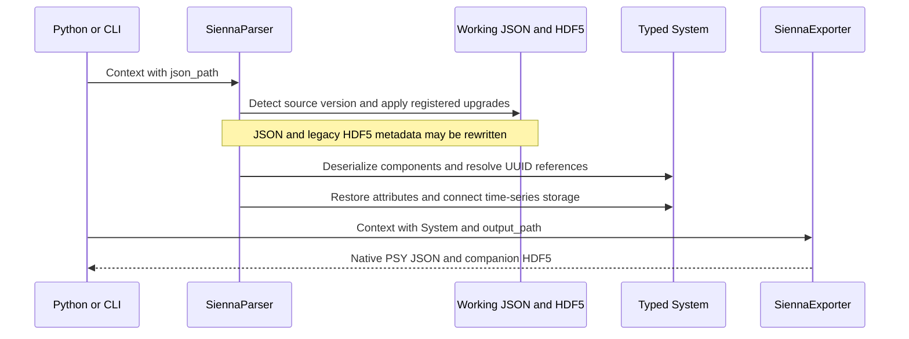
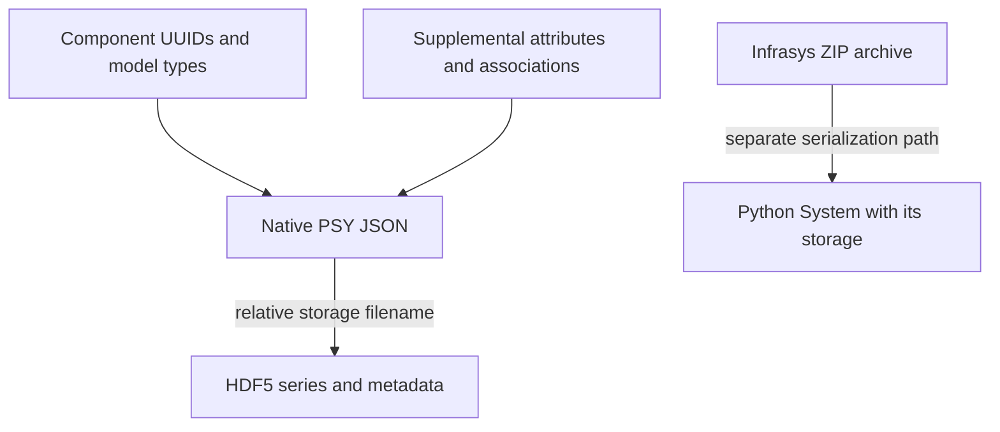

Native PSY JSON describes components, UUID references, supplemental attributes
and time-series storage. Reconstructing it requires more than calling a Pydantic
constructor for every JSON object: references can point to components that have
not yet been built, and legacy schemas can use different model names or fields.

## Why upgrading is a separate stage

Compatibility transformations run before component deserialization so the parser
can work against the current model definitions. Examples include legacy hydro
model splits, transformer fields and HVDC naming. HDF5 migration handles legacy
embedded metadata. A transformation may write back to the source file, so a
working copy is part of the workflow, not merely an optional backup step.

Version detection checks top-level `data_format_version` and the older
`data.version_info.version`. A context may select a target version; the registered
steps determine supported transitions. Do not assume an arbitrary newer or older
schema can be converted. See [upgrader design](/r2x-sienna/explanation/upgrader/) and
[registered steps](https://github.com/NatLabRockies/r2x-sienna/blob/main/src/r2x_sienna/upgrader/upgrade_steps.py).

## Why the graph and storage travel together

The [parser](https://github.com/NatLabRockies/r2x-sienna/blob/main/src/r2x_sienna/parser.py) reconstructs components, resolves nested/reference
fields, restores supplemental attributes and connects HDF5 storage metadata.
The [exporter](https://github.com/NatLabRockies/r2x-sienna/blob/main/src/r2x_sienna/exporter.py) serializes supported components and attributes,
then patches storage metadata needed by InfrastructureSystems.jl.

Moving JSON without the referenced HDF5 can leave a model with incomplete inputs.
The separate Infrasys archive is useful for Python inspection and pipeline handoff,
but it is not the native PSY format. Use `sienna-parser` for native input and
`r2x read --zip` for the archive produced by the tutorial.

## Units, base power and compatibility

`system_base_power` defaults to 100 MVA. Sienna model mixins/getters support
per-unit behavior, while [quantity types](/r2x-sienna/reference/units/) encode physical
units. Export normalizes those values into PSY representations. Changing a year
or base-power setting is not a general conversion of every timestamp or model
assumption; inspect values and profiles before using the result.

A successful Python export only verifies the Python serialization path. Model
classes and migration steps encode particular PSY schema assumptions. Load the
native JSON/HDF5 pair in the intended
[PowerSystems.jl](https://github.com/Sienna-Platform/PowerSystems.jl) environment
to verify that consumer's requirements before simulation.

## Package responsibilities

[`r2x-core`](https://github.com/NatLabRockies/r2x-core) controls lifecycle and
contexts; [Infrasys](https://github.com/NatLabRockies/infrasys) owns shared graph
and time-series operations. This package owns PSY models, upgrades and serialization.
[`r2x-cli`](https://github.com/NatLabRockies/r2x-cli) discovers plugins and saves
portable artifacts. For a PLEXOS target, use the separate
[`r2x-sienna-to-plexos`](https://github.com/NatLabRockies/R2X/tree/main/packages/r2x-sienna-to-plexos)
translator and [`r2x-plexos`](https://github.com/NatLabRockies/r2x-plexos) exporter.
Follow the [Sienna-to-PLEXOS guide](https://natlabrockies.github.io/R2X/how-to/sienna-to-plexos/)
for that mapping rather than expecting parse/export alone to convert formats.
