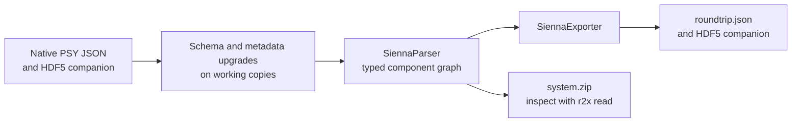

By the end, you will have parsed a public model, exported a native model, and
loaded a portable archive to check its component graph. This is a format round trip;
it does not run a PowerSystems.jl simulation or establish numerical equivalence.



## 1. Confirm the prerequisites

Complete [Installation](/r2x-sienna/getting-started/installation/),
[environment setup](/r2x-sienna/getting-started/environment/) and
[verification](/r2x-sienna/getting-started/verify/) first.
The CLI must discover `sienna-parser` and `sienna-exporter` in its managed environment.

This tutorial uses a macOS/Linux shell, `curl`, network access for the pinned
downloads, and a new working directory. A Julia installation is not required. Use disposable JSON/HDF5 copies because parser upgrades may rewrite input files.

## 2. Download a small, reproducible input

Choose a new directory so earlier results cannot be confused with this run:

```bash
mkdir r2x-sienna-demo
```

```bash
cd r2x-sienna-demo
```

Keep source files and output artifacts separate:

```bash
mkdir inputs outputs
```

Download the two-area PSY system from a pinned revision. It has ten buses: five in each area. Keep this JSON and its HDF5 companion together with their original filenames.

```bash
curl -fsSL \
  https://raw.githubusercontent.com/NatLabRockies/r2x-sienna/4a5b365e8637ebb56e5cf389b32eec801265072f/tests/data/2area-5bus-system/test_system.json \
  -o inputs/test_system.json
```

Download the companion HDF5 file from the same revision:

```bash
curl -fsSL \
  https://raw.githubusercontent.com/NatLabRockies/r2x-sienna/4a5b365e8637ebb56e5cf389b32eec801265072f/tests/data/2area-5bus-system/test_system_time_series_storage.h5 \
  -o inputs/test_system_time_series_storage.h5
```

Verify the downloads are present and nonempty:

```bash
ls -lh inputs
```

The parser may rewrite legacy JSON and migrate HDF5 metadata. These are disposable downloaded copies; preserve original study data before using the same procedure on a real model. See [upgrade behavior](/r2x-sienna/explanation/upgrader/).

## 3. Describe the two steps

Save the following as `pipeline.yaml` in the current directory:

```yaml
variables:
  input_dir: inputs
  output_dir: outputs
pipelines:
  round_trip:
    - r2x-sienna.sienna-parser
    - r2x-sienna.sienna-exporter
config:
  r2x-sienna.sienna-parser:
    json_path: ${input_dir}/test_system.json
    system_name: Two-area
    model_year: 2029
  r2x-sienna.sienna-exporter:
    output_path: ${output_dir}/roundtrip.json
output_folder: ${output_dir}
```

`pipelines` defines execution order; `config` gives each plugin its own settings.
`${input_dir}` and `${output_dir}` expand from `variables`.
The parser reads native PSY JSON and reconstructs component references. The exporter writes native PSY JSON and companion HDF5 to a separate output location. `system_name` controls the parsed system label; `model_year` is a parser setting, not a promise to rewrite every data timestamp.

List the pipeline before executing it:

```bash
r2x run pipeline.yaml --list
```

Expect `round_trip` with two steps. Print the expanded configuration:

```bash
r2x run pipeline.yaml round_trip --print
```

Check the input paths and output JSON filename in that output.
Preview the order without parsing any model data:

```bash
r2x run pipeline.yaml round_trip --dry-run
```

Expect `sienna-parser → sienna-exporter`. A dry run checks discovery and pipeline
configuration; it cannot prove that an XML object, JSON field, or sidecar exists.

## 4. Run and keep a portable system

```bash
r2x run pipeline.yaml round_trip --zip -o outputs/system.zip
```

The CLI reports each completed step and the saved ZIP. These are distinct outputs:

| Output | What it contains | How to read it |
| --- | --- | --- |
| `outputs/roundtrip.json` | Native PSY system and references to companion storage. | PowerSystems.jl or `sienna-parser`. |
| `outputs/roundtrip_time_series_storage.h5` | Native companion time-series storage. | Keep beside `roundtrip.json`. |
| `outputs/system.zip` | Infrasys serialization of the parsed system and its storage. | `r2x read --zip` or `System.load`. |

List what this run created:

```bash
ls -lh outputs
```

The native export and the archive serve different consumers. Do not pass
native PSY JSON to `r2x read` as if it were an Infrasys serialization.

## 5. Inspect the graph, not just the filenames

Copy the console input below without `>>>`/`...` prompts into `inspect_system.py` beside `pipeline.yaml`:

```python doctest
>>> from infrasys import Component
>>> from r2x_sienna.models import ACBus, PowerLoad
>>> print("System:", sys.name)
System: Two-area
>>> assert len(list(sys.get_components(Component))) == 53
>>> print("Components:", len(list(sys.get_components(Component))))
Components: 53
>>> print("Buses:", len(list(sys.get_components(ACBus))))
Buses: 10
>>> loads = list(sys.get_components(PowerLoad))
>>> print("Loads:", len(loads))
Loads: 6
>>> if loads:
...     print("First load:", loads[0].name)
...     print("Fields:", list(type(loads[0]).model_fields))
...     for series in sys.list_time_series(loads[0]):
...         print("Series:", series.name, series.initial_timestamp, series.resolution)
...         print("First values:", series.data[:3])
...
First load: Load-nodeD2
Fields: ['uuid', 'name', 'available', 'category', 'ext', 'services', 'dynamic_injector', 'bus', 'active_power', 'reactive_power', 'max_active_power', 'max_reactive_power', 'base_power', 'conformity']
```

`r2x read` supplies the loaded system as `sys`. The imports select the actual
package-specific model classes recorded in the archive. Execute the checks:

```bash
r2x read outputs/system.zip --zip --exec inspect_system.py
```

For the pinned fixture, the observed counts are:

```text
System: Two-area
Components: 53
Buses: 10
Loads: 6
```

The script also prints one load’s schema fields and any attached single time series. Review series timestamps and resolution independently of `model_year`; profiles need their own data checks.
Use these counts as a checkpoint for this fixture, not as expectations for a study model.
If loading or summary metadata fails, use [artifact troubleshooting](/r2x-sienna/troubleshooting/#archive-loading-fails).

## Where to go next

- [Inspect fields and time series](/r2x-sienna/how-to/inspect-system/) before changing model data.
- [Use Python contexts](/r2x-sienna/how-to/python/) when inserting custom analysis between parsing and export.
- [Translate Sienna to PLEXOS](https://natlabrockies.github.io/R2X/how-to/sienna-to-plexos/) uses the separate `r2x-sienna-to-plexos` package and `r2x-plexos` exporter.
- [Public API and defaults](/r2x-sienna/reference/) explain what each configuration field controls.

This walkthrough was executed with CLI 0.1.15 and Python 3.12, using
r2x-sienna 0.5.0, r2x-core 0.9.0, and Infrasys 1.2.1.
